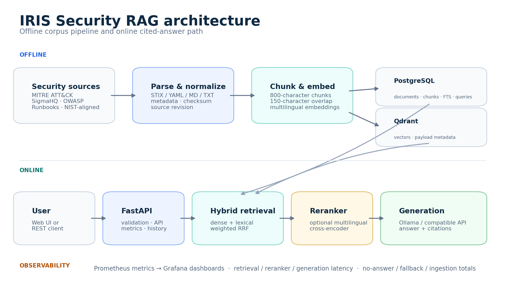
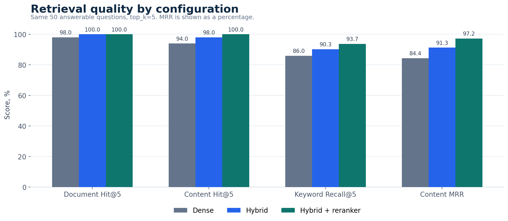
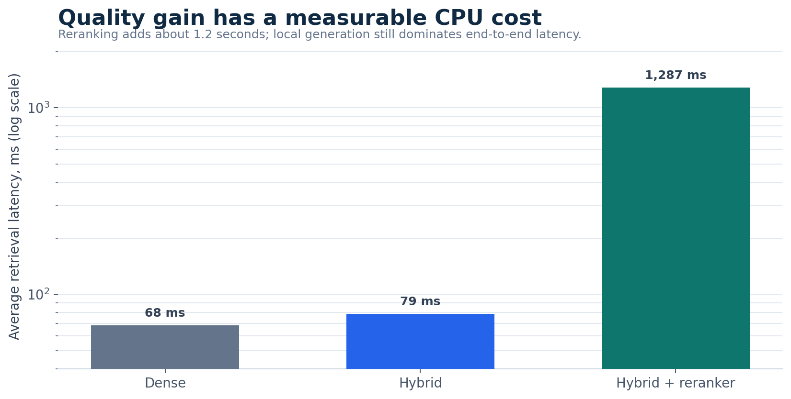
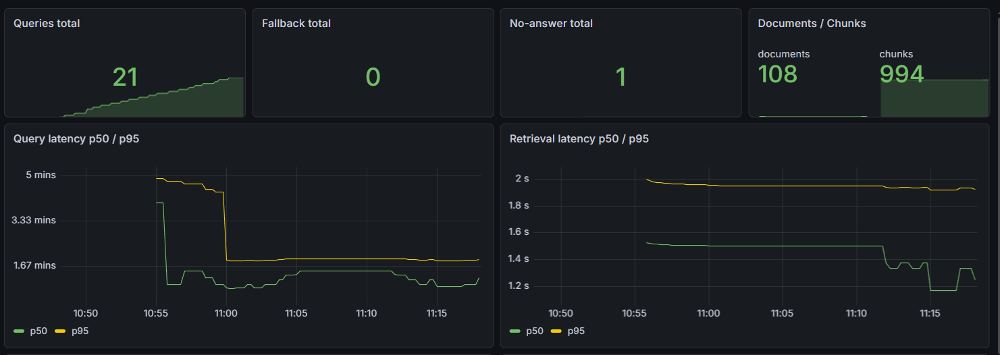
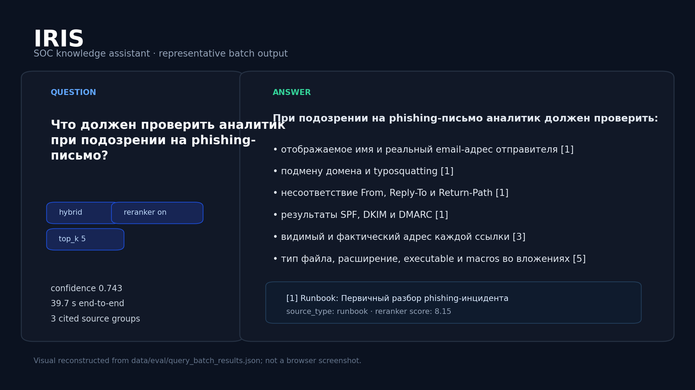

# IRIS Security RAG — Engineering Case Study

**Author:** Max Nikiforov  
**Date:** 6 August 2026  
**Role demonstrated:** AI / ML Engineer, RAG and backend engineering  
**Environment:** Windows 10, CPU-only inference, 16 GB RAM

## Executive summary

IRIS is a local-first Retrieval-Augmented Generation system designed as decision support for SOC analysts. It turns a mixed security corpus into cited answers and makes the retrieval, generation, and operational trade-offs measurable.

The project goes beyond a minimal vector-search demo. It includes reproducible source acquisition, format-specific parsing, normalized metadata, PostgreSQL and Qdrant storage, dense and lexical retrieval, weighted Reciprocal Rank Fusion, optional cross-encoder reranking, local LLM generation through Ollama, a no-answer guard, a FastAPI API, a browser UI, offline evaluation, and Prometheus/Grafana observability.

The best retrieval configuration reached 100% Content Hit@5 and 0.972 Content MRR on 50 answerable questions. A separate 20-request HTTP batch completed without transport errors and produced cited answers for every accepted query. The experiment also exposed two honest limitations: CPU generation dominates latency, and the current retrieval-score guard can reject relevant evidence after reranking.

## 1. Problem statement

Security knowledge is fragmented across different formats and abstraction levels:

- MITRE ATT&CK explains adversary techniques;
- Sigma expresses detection logic in YAML;
- OWASP describes application-security risks;
- runbooks define local triage and response actions;
- risk-management guidance provides broader control context.

A SOC analyst may need all of them for one question. Keyword search can miss semantic matches, while pure vector search can underweight exact indicators, technique IDs, commands, and filenames. A generated answer without traceable evidence is also unsuitable for operational security work.

IRIS therefore targets four outcomes: retrieve relevant evidence, preserve source provenance, refuse weak context, and expose measurable quality and latency.

## 2. Engineering requirements

The implementation was designed around the following constraints:

1. **Local-first operation.** The main experiment must run without a paid cloud LLM.
2. **CPU-friendly stack.** The development laptop has 16 GB RAM and no discrete GPU.
3. **Multilingual queries.** Russian questions must retrieve English security material.
4. **Citations by default.** Answers must reference the retrieved context.
5. **Reproducibility.** Official source revisions and evaluation artifacts must be preserved.
6. **Honest no-answer behavior.** The system should reject insufficient context instead of inventing an answer.
7. **Observability.** Retrieval, reranking, generation, fallback, and ingestion behavior must be measurable.

## 3. System architecture



### Offline data path

The corpus builder downloads selected MITRE ATT&CK STIX data, SigmaHQ rules, and OWASP Top 10:2025 Markdown from official repositories. It resolves repository commits, transforms source-specific formats into normalized Markdown, and writes a manifest with upstream URLs, revisions, and SHA-256 hashes.

The ingestion pipeline extracts metadata, performs deterministic chunking, and writes document/chunk records to PostgreSQL. A separate indexing step embeds chunks with `sentence-transformers/paraphrase-multilingual-MiniLM-L12-v2` and upserts vectors plus payload metadata into Qdrant.

### Online query path

The API accepts a question, `top_k`, retrieval strategy, and reranker flag. Dense candidates come from Qdrant; lexical candidates come from PostgreSQL full-text search. Hybrid mode merges ranked lists with weighted RRF. The optional multilingual cross-encoder reranks a larger candidate pool. The best contexts are passed to the generation service, which returns an answer with citations or a guarded no-answer response.

Prometheus instruments the online path. Grafana visualizes totals, query rate, retrieved chunk counts, fallbacks, no-answer events, and p50/p95 latency for retrieval, generation, and the full request.

## 4. Corpus and provenance

| Source | Documents | Chunks | Notes |
|---|---:|---:|---|
| MITRE ATT&CK | 30 | 277 | Official STIX techniques converted to Markdown |
| Sigma | 64 | 461 | Detection rules converted from YAML |
| OWASP Top 10:2025 | 10 | 214 | Official English Markdown |
| NIST-aligned ransomware summary | 1 | 10 | Manually curated, not an official NIST file |
| Russian SOC runbooks | 3 | 32 | Synthetic operational documents |
| **Total** | **108** | **994** | Average 9.2 chunks per document |

The official-source manifest contains 100 generated documents: 30 MITRE, 60 Sigma, and 10 OWASP. Four additional legacy Sigma documents, three runbooks, and one NIST-aligned summary bring the indexed database to 108 documents.

This distinction matters. The repository does not present manually authored material as official NIST or vendor documentation. The current audit reports no empty documents, no legacy `source_type` values, and no documents without chunks, but it flags incomplete provenance fields for eight manually added or legacy documents.

## 5. Retrieval design

### Dense retrieval

Dense retrieval embeds the multilingual question and queries Qdrant with cosine similarity. It is fast and handles paraphrases, but exact security tokens can be diluted by semantic similarity.

### Lexical retrieval

PostgreSQL full-text search preserves exact signals such as ATT&CK IDs, command-line switches, process names, and Sigma terms. Its weakness is vocabulary mismatch between Russian questions and English documents.

### Hybrid fusion

Hybrid mode combines dense and lexical rankings using weighted Reciprocal Rank Fusion. RRF is robust because it works with ranks rather than trying to directly compare vector and lexical scores with different scales.

### Optional reranking

`cross-encoder/mmarco-mMiniLMv2-L12-H384-v1` scores the query and candidate texts jointly. It improves content-level ordering but is much more expensive on CPU. The system therefore exposes reranking as an option instead of making it mandatory.

## 6. Generation and safety behavior

The generator receives only retrieved context and explicit citation identifiers. The default local model in the experiment is `qwen3:4b` served by Ollama. The architecture also supports OpenAI-compatible endpoints and an extractive provider.

The response contract contains:

- `answer` and `is_answerable`;
- confidence and rejection reason;
- citation-aware source objects;
- retrieval strategy and reranker state;
- total, retrieval, reranker, and generation latency;
- provider and fallback metadata.

A retrieval-based guard prevents generation below a minimum score. This reduces unsupported answers but must be calibrated carefully because fused retrieval scores and cross-encoder scores have different meanings.

## 7. Evaluation methodology

The golden dataset contains 55 questions: 50 answerable and 5 unanswerable. Questions cover phishing, PowerShell, ransomware, MITRE techniques, Sigma detections, OWASP risks, and negative cases.

Retrieval configurations were compared under the same conditions:

- same corpus and embeddings;
- same 50 answerable questions;
- `top_k=5`;
- document-level and content-level relevance labels;
- keyword coverage for expected concepts;
- per-query latency;
- no generator in the retrieval comparison.

The most important metrics are:

- **Document Hit@5:** whether a relevant document appears in the top five;
- **Content Hit@5:** whether a chunk containing the expected evidence appears;
- **Keyword Recall@5:** coverage of expected answer concepts;
- **MRR:** how early the first relevant result appears.

## 8. Retrieval results

| Configuration | Document Hit@5 | Content Hit@5 | Keyword Recall@5 | Primary MRR | Content MRR | Avg latency |
|---|---:|---:|---:|---:|---:|---:|
| Dense | 98% | 94% | 86.0% | 0.940 | 0.844 | 68 ms |
| Hybrid | 100% | 98% | 90.3% | 0.990 | 0.913 | 79 ms |
| Hybrid + reranker | 100% | 100% | 93.7% | 0.967 | 0.972 | 1,287 ms |



The hybrid configuration is the practical default: it materially improves quality for about 10 ms additional average retrieval latency. Reranking gives the strongest content evidence and perfect Content Hit@5, but adds roughly 1.2 seconds on CPU.

The results also show why multiple metrics are needed. Reranking increases Content MRR from 0.913 to 0.972, but Primary/Document MRR decreases from 0.990 to 0.967. A single headline score would hide that trade-off.



## 9. End-to-end operational experiment

The retrieval benchmark does not test HTTP handling, generation, fallbacks, or monitoring. A separate batch runner therefore sent real requests through `/api/v1/query`.

Configuration:

- one warm-up request;
- 20 measured questions;
- sequential execution;
- hybrid retrieval and reranking enabled;
- `top_k=5`;
- 300-second per-request timeout;
- local `qwen3:4b` generation on CPU.

| Metric | Result |
|---|---:|
| Successful HTTP requests | 20 / 20 |
| HTTP failures | 0 |
| Answers | 19 |
| No-answers | 1 |
| Accepted answers with sources | 100% |
| Fallback count | 0 |
| Average latency | 63.45 s |
| p50 latency | 70.68 s |
| p95 latency | 83.44 s |
| Average reranker latency | 1.18 s |
| Wall time | 24 min 55 s |



Grafana recorded 21 queries because the warm-up request also updated Prometheus counters. The latency split shows that generation takes tens of seconds, while reranking is around one second and retrieval remains far smaller. The experiment therefore identifies model inference, not search, as the primary local bottleneck.

## 10. Failure analysis: q004

The only no-answer was: “Какие вложения в письме считаются особенно опасными?” The first reranked result was the correct phishing runbook chunk, with a strong cross-encoder score of 5.70. Nevertheless, the guard rejected generation because the fused retrieval score was 0.358, below the configured threshold of 0.50.

This is not evidence that the answer was unavailable. It is evidence that the guard is calibrated on a score that does not reflect post-reranking relevance. A better design would evaluate the final ranked evidence using a calibrated reranker threshold, a small answerability classifier, or a combined rule validated on both answerable and unanswerable questions.

## 11. What the project demonstrates

- Designing a RAG system as a pipeline rather than a single framework call.
- Working with heterogeneous, real-world source formats.
- Separating PostgreSQL metadata/lexical concerns from Qdrant vector search.
- Evaluating retrieval with controlled comparisons and multiple metrics.
- Treating no-answer logic and citations as product requirements.
- Instrumenting the real HTTP path and diagnosing performance bottlenecks.
- Reporting limitations and negative findings instead of presenting only favorable metrics.

## 12. Limitations

- Results come from a small, domain-specific dataset and should not be generalized broadly.
- Generation quality was not independently scored in the operational batch run.
- Five unanswerable questions are insufficient for robust guard calibration.
- CPU-only local inference dominates latency.
- Eight manually added or legacy documents need complete provenance metadata.
- The NIST-aligned summary and runbooks are manually authored.
- Redis is present in infrastructure but not connected to the online query path.
- The application is a portfolio prototype, not a hardened multi-user production service.

## 13. Next steps

1. Rebuild the guard around final reranker evidence and calibrate it on a larger negative set.
2. Replace the NIST-aligned summary with a revision-pinned official NIST publication.
3. Complete missing provenance fields and enforce them in ingestion tests.
4. Add answer-faithfulness and citation-correctness evaluation.
5. Connect Redis with an explicit cache invalidation policy.
6. Add CI, an API container, rate limiting, and authentication.
7. Benchmark GPU and hosted inference against the CPU baseline.

## 14. Reproducibility

Key configuration:

| Component | Value |
|---|---|
| Python | 3.11+ |
| Embeddings | `sentence-transformers/paraphrase-multilingual-MiniLM-L12-v2` |
| Vector database | Qdrant |
| Relational / lexical store | PostgreSQL 16 |
| Fusion | Weighted RRF, `k=60` |
| Reranker | `cross-encoder/mmarco-mMiniLMv2-L12-H384-v1` |
| Generator | Ollama, `qwen3:4b` |
| API | FastAPI |
| Metrics | Prometheus + Grafana |
| Experiment hardware | Windows 10 laptop, CPU-only, 16 GB RAM |

Reproduce the retrieval comparison:

```cmd
python scripts\compare_retrieval.py
```

Reproduce the HTTP batch:

```cmd
python scripts\run_query_batch.py --limit 20 --strategy hybrid --reranker
```

Raw artifacts are stored in `data/eval/`. Repository source notices are listed in `THIRD_PARTY_NOTICES.md`.

## 15. Representative answer

The visual below is reconstructed from the first successful record in `data/eval/query_batch_results.json`. It preserves the measured question, answer claims, citation identifiers, confidence, latency, and top source metadata without pretending to be a browser screenshot.



## 16. Evidence and source references

A technical reviewer can verify the main claims without reproducing the entire environment:

| Artifact | What it demonstrates |
|---|---|
| `golden_questions.yml` | Question set and relevance expectations |
| `retrieval_comparison.json` | Per-query and aggregate retrieval metrics |
| `query_batch_results.json` | End-to-end HTTP outcomes and latency |
| `latest_corpus_audit.json` | Corpus counts and metadata gaps |
| `corpus_sources.json` | Upstream revisions, URLs, and checksums |

Primary external source projects:

- [MITRE ATT&CK](https://attack.mitre.org/)
- [MITRE ATT&CK STIX data](https://github.com/mitre-attack/attack-stix-data)
- [SigmaHQ rule repository](https://github.com/SigmaHQ/sigma)
- [OWASP Top 10 repository](https://github.com/OWASP/Top10)
- [NIST ransomware publications](https://csrc.nist.gov/projects/ransomware-protection-and-response)
